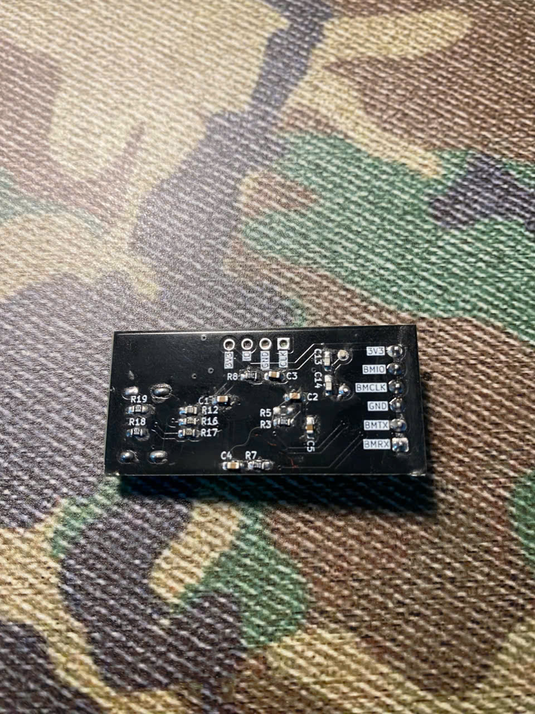

# 🔧 BMP Clone & TUE CMSIS-DAP Programmer / Debugger

Repository chứa phần cứng KiCad, firmware và phần mềm nạp/debug cho hai phiên bản mạch nạp STM32:

1. **`stm32f401rct6_stlink/` (Phiên bản mới - v2.1.0):** Mạch nạp **TUE CMSIS-DAP + Virtual COM Port** dùng **STM32F401RCT6**, kèm ứng dụng **GUI nhân C++17 thuần** cho **Windows** và **Ubuntu**.
2. **`blackmagic-firmware-v1.10.2/` & `hardware/`:** Mạch **Black Magic Probe (BMP)** dùng **STM32F103C8T6 (Bluepill)**.

---

## 📁 Cấu trúc thư mục

| Thư mục / File | Mô tả |
| :--- | :--- |
| [`stm32f401rct6_stlink/`](stm32f401rct6_stlink/firmware/README.md) | Dự án mạch nạp STM32F401RCT6 (KiCad PCB + Firmware CMSIS-DAP/VCP + GUI C++ + Release v2.1.0) |
| [`stm32f401rct6_stlink/firmware/`](stm32f401rct6_stlink/firmware/README.md) | Mã nguồn firmware STM32F401RCT6 (USB Composite HID + CDC VCP, SWD, LED công nghiệp) |
| [`stm32f401rct6_stlink/gui/`](stm32f401rct6_stlink/gui/main_gui.cpp) | Giao diện Native C++17 (Win32 API cho Windows & Qt5 cho Ubuntu) |
| [`stm32f401rct6_stlink/release/v2.1.0/`](stm32f401rct6_stlink/release/v2.1.0/RELEASE_NOTES.md) | Bộ file Release v2.1.0 (`.bin`/`.hex` STM32F401, `.exe` Windows, `.deb` Ubuntu) |
| `blackmagic-firmware-v1.10.2/` | Firmware Black Magic Probe v1.10.2 cho STM32F103C8T6 |
| `hardware/` & `Tue_BMP_Gerber/` | Thiết kế phần cứng KiCad & file Gerber cho bản Bluepill BMP |

---

## 🚀 Phần 1: TUE CMSIS-DAP (STM32F401RCT6 - Khuyên dùng)

### ✨ Tính năng chính
* **USB Composite (`VID=0x0483`, `PID=0x5752`):**
  * **Interface 0:** `CMSIS-DAP v1.10` HID (tương thích OpenOCD, pyOCD, Keil MDK, STM32CubeIDE, Probe-rs).
  * **Interface 1 & 2:** `USB Serial Device (VCP)` cầu nối trực tiếp ra `USART1` (`PA9` TX / `PB7` RX).
* **LED trạng thái chuẩn công nghiệp (`PC13`):**
  * *Heartbeat (2 chớp / 1.2s):* Idle / Sẵn sàng.
  * *Sáng liên tục:* Đã kết nối SWD / Target.
  * *Nháy nhanh (16.7 Hz):* Đang nạp / Xóa / Verify Flash.
  * *Nháy kép (1.0s):* Target CPU đang Halted (Debug).
  * *3 chớp dồn dập:* Lỗi SWD / Verify mismatch.
* **Nút bấm phần cứng (`PA0`):** Giữ nút để kéo chân `PB8` (`nRESET`) xuống `0V` (nhả ra về `3.3V` ngay).
* **GUI Native C++17 siêu nhẹ (`stm32f401rct6_stlink/gui/`):**
  * Tự động nhận thiết bị USB Plug & Play (HID + COM).
  * Nạp / Verify / Mass Erase trực tiếp file `.bin`, `.hex`, `.elf` cho **STM32F1 / F3 / F4 / G4 / L4** không cần OpenOCD, hoặc tick **`Use OpenOCD`** để dùng qua OpenOCD + GDB Server (`:3333`).
  * Đọc trực tiếp tên chip, ID, dung lượng Flash, RDP, UID và 256 bytes Flash đầu tiên khi nhấn **Connect**.
  * 9 mức tốc độ SWD (`4 MHz` – `20 kHz`), **Memory Hex Viewer & Mem32**, và **UART Terminal** (`Echo TX`, tự xóa ô nhập, tùy chọn tick `\r`, `\n`, `\t`, `Parse \r \n \t \xHH`).

### 📦 Tải & Cài đặt nhanh (Release v2.1.0)
* **Firmware STM32F401RCT6:** Nạp `stm32f401rct6_stlink/release/v2.1.0/tue-cmsis-dap-stm32f401rct6-v2.1.0.bin` tại địa chỉ `0x08000000` (qua DFU hoặc ST-Link).
* **Windows:** Chạy trực tiếp `stm32f401rct6_stlink/release/v2.1.0/TUE_CMSIS_DAP_Windows_v2.1.0.exe`.
* **Ubuntu / Linux:**
  ```bash
  sudo apt install ./stm32f401rct6_stlink/release/v2.1.0/tue-cmsis-dap_2.1.0_amd64.deb
  tue-cmsis-dap
  ```
* Xem hướng dẫn chi tiết build firmware & GUI tại: [`stm32f401rct6_stlink/firmware/README.md`](stm32f401rct6_stlink/firmware/README.md).

---

## 🔧 Phần 2: Black Magic Probe trên STM32F103C8T6 (Bluepill)

This guide provides detailed instructions for loading Blackmagic firmware onto the Bluepill board using either an ST-Link or Black Magic Probe (BMP).

<table align="center">
  <tr>
    <th>Front</th>
    <th>Back</th>
  </tr>
  <tr>
    <td></td>
    <td></td>
  </tr>
</table>

### 📂 1. Prepare the Firmware Files
Locate the following files in your build directory:
- `.../blackmagic-firmware-v1.10.2/bluepill/blackmagic_dfu-bluepill.elf`
- `.../blackmagic-firmware-v1.10.2/bluepill/blackmagic-bluepill.elf`

### 🛠️ 2. Install GDB Tool
Open **PowerShell** or **Terminal** and run:
```bash
arm-none-eabi-gdb
```

### ⚡ 3. Flash the Firmware

#### 🔹 Method A: Using ST-LINK
```bash
# Erase old memory
st-flash erase

# Flash the DFU Bootloader (at address 0x8000000)
st-flash --flash=0x20000 write .../blackmagic-firmware-v1.10.2/bluepill/blackmagic_dfu-bluepill.elf 0x8000000

# Flash the main firmware (at address 0x8002000) and reset
st-flash --flash=0x20000 --reset write .../blackmagic-firmware-v1.10.2/bluepill/blackmagic-bluepill.elf 0x8002000
```

#### 🔹 Method B: Using Black Magic Probe (BMP)
```bash
target extended-remote \\.\COMx           # For Windows
target extended-remote /dev/tty*          # For Linux

monitor swdp_scan
attach 1
monitor halt
monitor erase_mass

file .../blackmagic-firmware-v1.10.2/bluepill/blackmagic_dfu-bluepill.elf
load

file .../blackmagic-firmware-v1.10.2/bluepill/blackmagic-bluepill.elf
load

monitor reset
continue
```

### 🧠 Important Notes & Troubleshooting
- STM32F103 Flash starts at `0x08000000` (DFU Bootloader occupies `0x08000000 → 0x08002000`).
- After flashing, reconnect via USB to see **GDB Port** and **UART Port**.

| **Error** | **Cause** | **Solution** |
| :--- | :--- | :--- |
| `unknown architecture "arm"` | Incorrect GDB version | Use `arm-none-eabi-gdb`. |
| `load failed` | Memory not erased | Run `monitor erase_mass` before loading. |
| `attach` error | Physical connection issue | Check `monitor swdp_scan`. |
| Target not detected | Loose or incorrect SWD wires | Verify SWDIO and SWCLK connections. |
