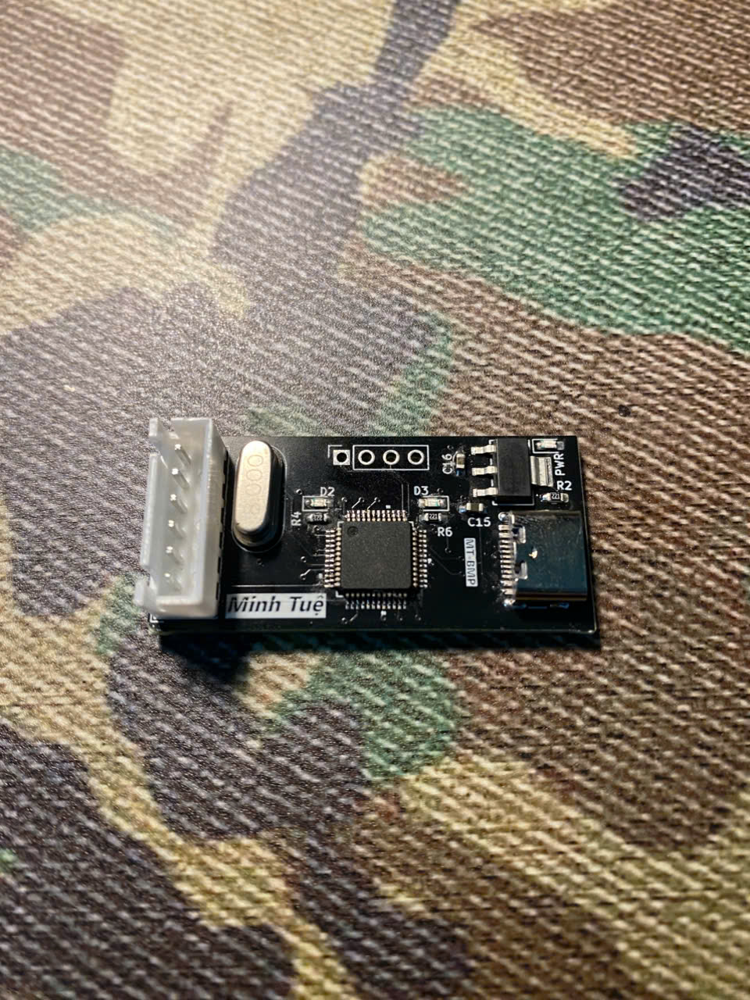

# 🔧 BMP Clone & TUE CMSIS-DAP Programmer / Debugger

This repository contains the KiCad hardware, firmware, and host software for two STM32 debug probe implementations:

1. **`stm32f401rct6_stlink/` (Latest - v1.0.1):** **CMSIS-DAP Programmer & Debugger + Virtual COM Port** probe based on **STM32F401RCT6**, paired with a lightweight **native C++17 GUI** for **Windows** and **Ubuntu**.
2. **`blackmagic-firmware-v1.10.2/` & `hardware/`:** **Black Magic Probe (BMP)** clone based on **STM32F103C8T6 (Bluepill)**.

---

## 📁 Repository Structure

| Folder / File | Description |
| :--- | :--- |
| [`stm32f401rct6_stlink/`](stm32f401rct6_stlink/firmware/README.md) | STM32F401RCT6 probe project (KiCad PCB + CMSIS-DAP/VCP Firmware + C++ GUI) |
| [`stm32f401rct6_stlink/firmware/`](stm32f401rct6_stlink/firmware/README.md) | STM32F401RCT6 firmware source & prebuilt `.bin`/`.hex` (`tue-cmsis-dap-stm32f401rct6.bin`) |
| [`stm32f401rct6_stlink/gui/`](stm32f401rct6_stlink/gui/main_gui.cpp) | Native C++17 GUI for Windows (`TUE_CMSIS_DAP_CPP.exe`) |
| [`stm32f401rct6_stlink/gui/linux/`](stm32f401rct6_stlink/gui/linux/linux_main.cpp) | Native C++17 Qt5 GUI & `.deb` package for Ubuntu (`tue-cmsis-dap_1.0.1_amd64.deb`) |
| `blackmagic-firmware-v1.10.2/` | Black Magic Probe v1.10.2 firmware for STM32F103C8T6 |
| `hardware/` & `Tue_BMP_Gerber/` | KiCad hardware design & Gerber files for the Bluepill BMP |

---

## 🚀 Part 1: TUE CMSIS-DAP (STM32F401RCT6 - Recommended)

### ✨ Key Features
* **USB Composite (`VID=0x0483`, `PID=0x5752`):**
  * **Interface 0:** `CMSIS-DAP v1.10` HID (compatible with OpenOCD, pyOCD, Keil MDK, STM32CubeIDE, Probe-rs).
  * **Interface 1 & 2:** `USB Serial Device (VCP)` bridged directly to `USART1` (`PA9` TX / `PB7` RX).
* **Industrial Status LED (`PC13`):**
  * *Single Blink (1.0s):* Idle / Standby (not connected).
  * *Double Blink (1.2s):* Target SWD Connected.
  * *Solid ON:* Debug Mode active (blinks **3 times** cleanly when executing a debug command, then returns to Solid ON).
  * *Rapid Continuous Flicker (12.5 Hz):* Active non-debug target operation (Flashing / Erasing / Verifying / Reset / Memory R/W) until completed.
  * *3 Fast Blinks (Error):* SWD Error / Verify Mismatch.
* **Hardware Reset Button (`PA0`):** Press and hold to pull `PB8` (`nRESET`) to `0V`; release to return to `3.3V` immediately (non-blocking).
* **Lightweight Native C++17 GUI (`stm32f401rct6_stlink/gui/`):**
  * Automatic USB Plug & Play detection (HID + COM).
  * Direct `.bin`, `.hex`, and `.elf` flashing/verifying/mass-erasing for **STM32F1 / F3 / F4 / G4 / L4** without OpenOCD, or toggle **`Use OpenOCD`** + GDB Server (`:3333`).
  * Clicking **Connect** reads the chip name, IDs, Flash size, RDP, UID, and the first 512 bytes of on-chip Flash; includes **Disconnect**, **HW Reset** / **SWD Reset**, and a dedicated **CPU Debug Window** (`Start Debug`, `Exit Debug`, `Halt`, `Run`, `Step Into`, `Step Out`, `Read Regs`).
  * 9 SWD clock speeds (`4 MHz` – `20 kHz`), **Memory Hex Viewer & Mem32**, and **UART Terminal** (`Echo TX`, auto-clear input, selectable `\r`, `\n`, `\t`, and `Parse \r \n \t \xHH`).

### 📦 Quick Download & Install (Prebuilt Files in Folders)
* **STM32F401RCT6 Firmware:** Flash `stm32f401rct6_stlink/firmware/tue-cmsis-dap-stm32f401rct6.bin` (or `.hex`) at `0x08000000` (via DFU or ST-Link).
* **Windows:** Run `stm32f401rct6_stlink/gui/TUE_CMSIS_DAP_CPP.exe` directly.
* **Ubuntu / Linux:**
  ```bash
  sudo apt install ./stm32f401rct6_stlink/gui/linux/tue-cmsis-dap_1.0.1_amd64.deb
  tue-cmsis-dap
  ```
  *(Or run the standalone binary `stm32f401rct6_stlink/gui/linux/tue-cmsis-dap-ubuntu-x86_64`)*
* For detailed firmware & GUI build instructions, see [`stm32f401rct6_stlink/firmware/README.md`](stm32f401rct6_stlink/firmware/README.md).

---

## 🔧 Phần 2: Black Magic Probe trên STM32F103C8T6 (Bluepill)

This guide provides detailed instructions for loading Blackmagic firmware onto the Bluepill board using either an ST-Link or Black Magic Probe (BMP).

<table align="center">
  <tr>
    <th>Front</th>
    <th>Back</th>
  </tr>
  <tr>
    <td></td>
    <td></td>
  </tr>
</table>

### 📂 1. Prepare the Firmware Files
Locate the following files in your build directory:
- `.../blackmagic-firmware-v1.10.2/bluepill/blackmagic_dfu-bluepill.elf`
- `.../blackmagic-firmware-v1.10.2/bluepill/blackmagic-bluepill.elf`

### 🛠️ 2. Install GDB Tool
Open **PowerShell** or **Terminal** and run:
```bash
arm-none-eabi-gdb
```

### ⚡ 3. Flash the Firmware

#### 🔹 Method A: Using ST-LINK
```bash
# Erase old memory
st-flash erase

# Flash the DFU Bootloader (at address 0x8000000)
st-flash --flash=0x20000 write .../blackmagic-firmware-v1.10.2/bluepill/blackmagic_dfu-bluepill.elf 0x8000000

# Flash the main firmware (at address 0x8002000) and reset
st-flash --flash=0x20000 --reset write .../blackmagic-firmware-v1.10.2/bluepill/blackmagic-bluepill.elf 0x8002000
```

#### 🔹 Method B: Using Black Magic Probe (BMP)
```bash
target extended-remote \\.\COMx           # For Windows
target extended-remote /dev/tty*          # For Linux

monitor swdp_scan
attach 1
monitor halt
monitor erase_mass

file .../blackmagic-firmware-v1.10.2/bluepill/blackmagic_dfu-bluepill.elf
load

file .../blackmagic-firmware-v1.10.2/bluepill/blackmagic-bluepill.elf
load

monitor reset
continue
```

### 🧠 Important Notes & Troubleshooting
- STM32F103 Flash starts at `0x08000000` (DFU Bootloader occupies `0x08000000 → 0x08002000`).
- After flashing, reconnect via USB to see **GDB Port** and **UART Port**.

| **Error** | **Cause** | **Solution** |
| :--- | :--- | :--- |
| `unknown architecture "arm"` | Incorrect GDB version | Use `arm-none-eabi-gdb`. |
| `load failed` | Memory not erased | Run `monitor erase_mass` before loading. |
| `attach` error | Physical connection issue | Check `monitor swdp_scan`. |
| Target not detected | Loose or incorrect SWD wires | Verify SWDIO and SWCLK connections. |
